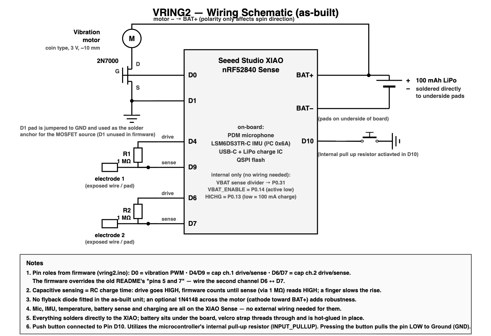

# VRing 2 Wiring Schematic

This is the current as-built wiring diagram for the calibration ring. It
supersedes the older SVG schematic and includes the physical pushbutton.

## External connections

| XIAO nRF52840 Sense connection | Connect to |
|---|---|
| D0 | 2N7000 MOSFET gate for the vibration motor |
| D1 | Ground and 2N7000 source; D1 is used as a convenient solder anchor |
| 2N7000 drain | Vibration motor positive lead |
| Motor negative lead | BAT+ |
| D4 → 1 MΩ → D9 | Capacitive channel 1; electrode is on the D9 side |
| D6 → 1 MΩ → D7 | Capacitive channel 2; electrode is on the D7 side |
| D10 | Pushbutton to ground; firmware uses the internal pull-up |
| BAT+ / BAT− underside pads | 100 mAh LiPo battery |

The microphone, IMU, temperature sensing, battery measurement, and charging
control are on-board. No external wiring is required for them.

The button is active-low: pressing it connects D10 to ground.
