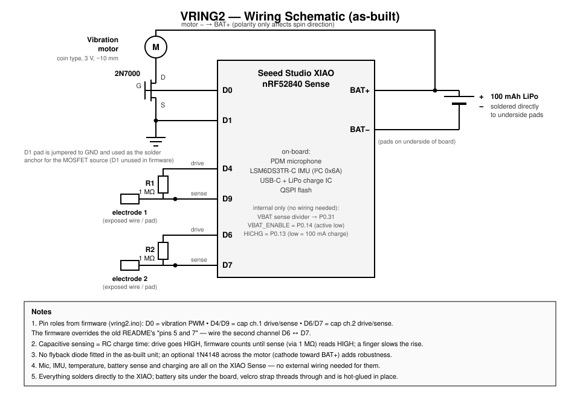

# VRING2 Schematics & Build Guide

This folder documents the electrical design of the VRING2 so you can build one from scratch.
The wiring below was reverse-engineered from the firmware ([vring2.ino](../vring2.ino)), the
top-level README, and photos of an assembled unit. **The firmware is treated as ground truth
for pin assignments.**

## Bill of Materials

| Qty | Part | Notes |
|-----|------|-------|
| 1 | Seeed Studio **XIAO nRF52840 Sense** | Must be the *Sense* variant — the PDM microphone and LSM6DS3TR-C IMU are on-board |
| 1 | **2N7000** N-channel MOSFET (TO-92) | Low-side switch for the vibration motor |
| 2 | **1 MΩ** resistor, 1/4 W axial | Brown-black-green bands. Charge resistors for the two capacitive touch channels |
| 1 | Coin / pancake **vibration motor**, 3 V, ~10 mm | Red/blue lead type; foam adhesive pad up |
| 1 | **100 mAh LiPo** battery (e.g. 401230-class) | Soldered directly to the BAT+/BAT− pads on the underside of the XIAO |
| 2 | Short insulated wires | Capacitive touch electrodes (bare end or pad touching the finger) |
| — | Velcro strap (~10–15 mm wide), hot glue, kapton tape | Mechanical assembly |

## Wiring (net list)

Everything is soldered directly to the XIAO to minimize bulk — no perfboard.

| XIAO pin | Connects to | Purpose |
|----------|-------------|---------|
| **D0** | 2N7000 **gate** | PWM vibration drive (`analogWrite`, 0–255) |
| **D1** | **GND**, and 2N7000 **source** | D1 is not used by firmware — its pad is tied to GND purely as a convenient, mechanically stable solder point for the MOSFET source |
| 2N7000 **drain** | Vibration motor **+** | Low-side switching |
| Vibration motor **−** | **BAT+ (VBAT)** | Motor polarity only affects spin direction — either way works for vibration |
| **D4** | 1 MΩ resistor → **D9** | Cap channel 1: D4 = drive, D9 = sense |
| **D9** | Touch electrode 1 | Bare wire/pad contacting or near the finger |
| **D6** | 1 MΩ resistor → **D7** | Cap channel 2: D6 = drive, D7 = sense |
| **D7** | Touch electrode 2 | Bare wire/pad contacting or near the finger |
| **BAT+ / BAT−** (underside pads) | 100 mAh LiPo **+ / −** | Direct solder; charges at ~100 mA from the USB-C port (firmware pulls the HICHG pin low) |

> **⚠️ Discrepancy note:** the top-level README says the second resistor bridges "pins 5 and 7",
> but the firmware uses **D6 (drive) and D7 (sense)** (`CAP_DRIVE2_PIN = D6`,
> `CAP_SENSE2_PIN = D7`). Wire it per the firmware: **D6 ↔ D7**. If you are copying an
> existing unit, verify with a continuity meter before assuming either.

No other external components are used:

* **Microphone, IMU, temperature** — on-board on the XIAO Sense (PDM mic; LSM6DS3TR-C on
  internal I²C at address 0x6A, powered via the board's IMU power rail pin).
* **Battery voltage sensing** — uses the XIAO's *internal* 1 MΩ/510 kΩ divider on P0.31,
  enabled by the firmware via P0.14 (`VBAT_ENABLE`). Nothing to wire.
* **Charge current** — the firmware drives P0.13 (`HICHG`) low to select 100 mA charging.
* There is **no flyback diode** across the motor in the as-built unit. It has worked fine
  (coin motors are low-inductance), but adding a small diode (e.g. 1N4148, cathode to the
  VBAT side) across the motor is a cheap robustness upgrade if you have one on hand.

## How the capacitive sensing works

Each channel is a classic RC charge-time sensor
(see `readCapacitiveValue()` in [vring2.ino:143](../vring2.ino)):

1. The drive pin (D4 / D6) is driven HIGH.
2. The sense pin (D9 / D7) charges through the 1 MΩ resistor.
3. Firmware counts loop iterations until the sense pin reads HIGH (timeout 50).
4. A finger touching (or nearing) the electrode adds body capacitance, slowing the
   rise — a larger count means more touch.

The "electrode" is simply the wire/solder junction on the sense pin side; leave a short
exposed conductor where the finger sits.

## Assembly notes (from the reference unit)

1. Solder the LiPo directly to the BAT+/BAT− pads on the underside of the XIAO. Insulate
   with kapton tape.
2. Bend the 2N7000 flat against the stack: gate to D0, source to the D1 pad (which you
   have also jumpered to GND), drain to a flying lead for the motor.
3. Stick the coin vibration motor onto the battery/stack with its adhesive foam pad facing
   out; wire one lead to the MOSFET drain, the other to BAT+.
4. Bend the two 1 MΩ resistors across the board edge between their pin pairs (D4↔D9,
   D6↔D7), keeping the sense-side junctions accessible as touch points.
5. Thread the velcro strap between the battery and the board (or under the stack) and hot
   glue everything in place. The strap doubles as the adjustable finger band.
6. Keep the USB-C port unobstructed for charging and flashing.

## Firmware / bring-up

Follow the build instructions in the [top-level README](../README.md) (Bluefruit non-mbed
core, arduino-libopus, Seeed LSM6DS3 library, Adafruit PDM). Flash `vring2.ino`, then open
`vring2.html` in Chrome (WebBLE) to verify: IMU quaternion + accel, both capacitive
channels, battery voltage, temperature, and vibration control (write 0–255).
